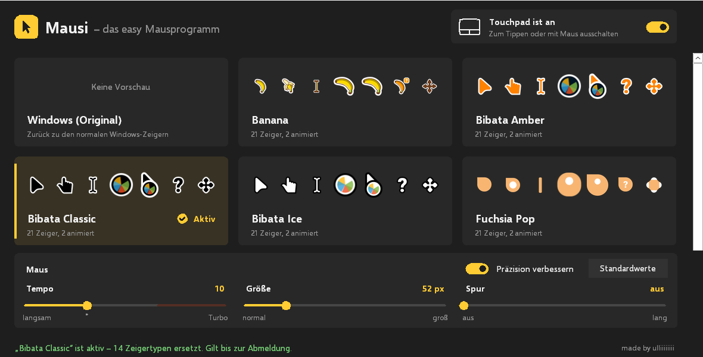

# Mausi – das easy Mausprogramm

Mausi wechselt unter Windows 10 und 11 die Mauszeiger paketweise und stellt Tempo, Größe und Spur der Maus ein. Ein Klick, keine Systemsteuerung, keine Installation.



## Was Mausi kann

- **Zeiger-Pakete:** Ein Klick auf ein Paket übernimmt alle Zeiger – Pfeil, Hand, Text, Warten, auch die animierten. „Windows (Original)“ holt die normalen Zeiger zurück.
- **Freie Pakete:** Beim ersten Start lädt Mausi Bibata, Banana, Fuchsia, GoogleDot, Pokémon und macOS dazu.
- **Eigene Zeiger:** Einen Zeiger-Ordner oder `.cur`/`.ani`-Dateien ins Fenster ziehen.
- **Tempo, Größe, Spur:** fein einstellbar, per Ziehen, Klick oder Mausrad.
- **Turbo:** schneller als das Windows-Maximum, bis ×3. Notbremse: **Strg+Alt+T**.
- **Touchpad an/aus** mit einem Klick, zum Beispiel beim Tippen.

## Installation

1. `Mausi.exe` unter [Releases](../../releases) herunterladen.
2. In einen eigenen Ordner legen und starten. Mausi legt daneben den Ordner `cursors` für die Pakete an.

Voraussetzung: Windows 10 oder 11 mit .NET Framework 4.8 (dort vorinstalliert). Adminrechte braucht Mausi nicht.
Der Touchpad-Schalter braucht ein Precision-Touchpad; ohne Touchpad blendet Mausi ihn aus.

## Was Mausi am System ändert

Mausi ändert nur Einstellungen deines eigenen Benutzerkontos:

| Was | Wo | Wie lange |
|---|---|---|
| Mauszeiger | `SetSystemCursor` | bis zur Abmeldung |
| Tempo, Spur, Präzision | Windows-Mauseinstellungen | dauerhaft, wie in den Einstellungen |
| Zeigergröße | `HKCU\Control Panel\Cursors` | dauerhaft |
| Turbo-Stufe | `HKCU\Software\Mausi` | dauerhaft |
| Autostart | `HKCU\Software\Microsoft\Windows\CurrentVersion\Run` | nur solange der Turbo an ist |
| Touchpad | eingebautes Windows-Kürzel Strg+Win+F24 | wie in den Einstellungen |

**Turbo:** Mausi vergrößert dafür über einen Maus-Hook (`WH_MOUSE_LL`) jede Mausbewegung. Das wirkt nur, solange Mausi läuft – deshalb bleibt Mausi bei aktivem Turbo im Infobereich und startet mit Windows. Ist der Zeiger ausgeblendet (wie in den meisten Spielen), lässt der Turbo alles unverändert. Ist der Turbo aus, ist kein Hook aktiv.
Manche Virenscanner werden bei Maus-Hooks und Autostart misstrauisch; der Quellcode liegt deshalb vollständig offen.

**Netzwerk:** nur beim ersten Start, um die freien Pakete aus ihren GitHub-Releases zu laden. Jede Zip-Datei wird gegen eine fest eingetragene SHA-256-Prüfsumme geprüft; passt sie nicht, verwirft Mausi das Paket.

## Selbst bauen

Eine Entwicklungsumgebung braucht es nicht – der C#-Compiler steckt in Windows:

```bat
build.cmd
```

Das baut `Mausi.exe` aus `src\mausi.cs` (eine Datei, C# 5, .NET Framework 4.x, WinForms).
GitHub baut bei jedem Push mit; ein Tag wie `v1.0.0` legt automatisch ein Release mit der fertigen `Mausi.exe` an.

Neue Version veröffentlichen: Versionsnummer oben in `src/mausi.cs` anpassen, committen und taggen:

```bash
git tag v1.1.0 && git push origin main v1.1.0
```

## Zeiger-Pakete und Marken

Die Pakete gehören nicht zu Mausi und werden nicht mitgeliefert. Mausi lädt sie aus den Releases ihrer Projekte; sie stehen unter **GPL-3.0** und stammen von [ful1e5](https://github.com/ful1e5):
[Bibata](https://github.com/ful1e5/Bibata_Cursor),
[Banana](https://github.com/ful1e5/banana-cursor),
[Fuchsia](https://github.com/ful1e5/fuchsia-cursor),
[GoogleDot](https://github.com/ful1e5/Google_Cursor),
[Pokémon](https://github.com/ful1e5/pokemon-cursor),
[macOS](https://github.com/ful1e5/apple_cursor).

Pokémon ist eine Marke von Nintendo, Creatures und GAME FREAK, macOS eine Marke von Apple. Beide Pakete sind inoffizielle Fan-Projekte; Mausi steht mit diesen Firmen in keiner Verbindung.

## Lizenz

[MIT](LICENSE)

---

**English:** Mausi is a small Windows 10/11 tool that switches whole mouse cursor packs with one click and tunes pointer speed (including a turbo beyond the Windows maximum, panic key Ctrl+Alt+T), size and trails, plus a touchpad on/off switch. No install, no admin rights. Build it with `build.cmd`, which uses the C# compiler that ships with Windows. MIT licensed; the downloadable cursor packs are GPL-3.0 by their authors and are not bundled.
